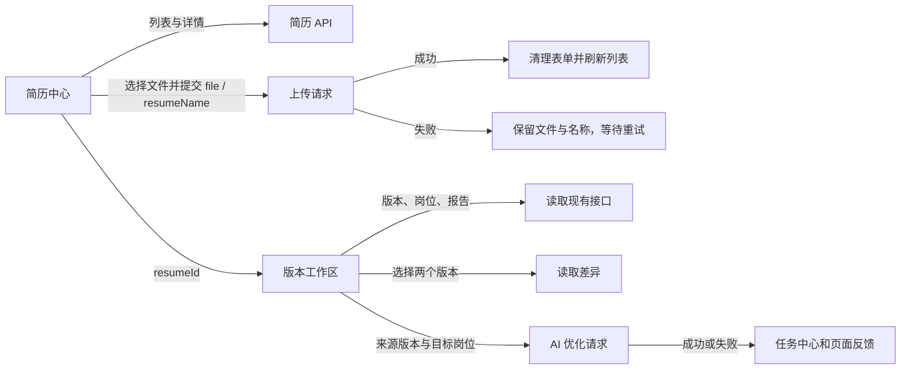
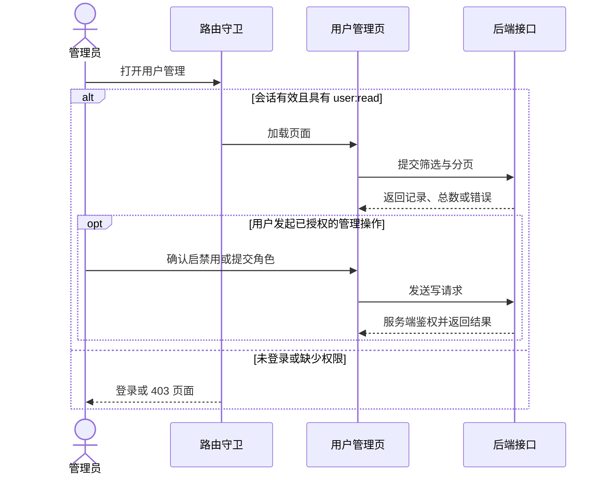
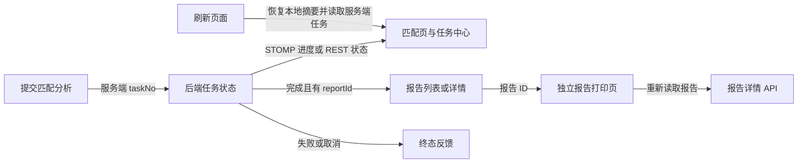

# 34 InternPilot 前端 UI 重设计详细设计与建模

改版基于 `7b0a47fc7df8c85d1048312afce4e660c2a73609`。本文记录改版后的页面职责、数据流和恢复路径。需求与验收状态见 [06 需求与验收](../requirements/06-frontend-ui-redesign-requirements.md)，组件与样式分工见 [05 概要设计](../architecture-overview/05-frontend-ui-redesign-outline.md)。

## 页面与批次

| 批次 | 路由 | 主要组件与职责 | 需求与验收记录 |
| --- | --- | --- | --- |
| P1 | `/resumes` | `ResumeList` 展示默认简历、解析状态、上传和版本入口 | REQ-C02/C03，[G2 验收](../architecture-overview/05-frontend-ui-redesign-outline.md#11-resumes-g2-接入与验收) |
| P2 | `/resumes/:resumeId/versions` | `ResumeVersionList` 展示当前版本、版本操作、差异对比和 AI 优化 | REQ-C04/C05，[P2 验收](35-frontend-ui-rollout-p2.md) |
| P3 | `/dashboard` | `Dashboard` 展示求职阶段和主要下一步操作 | REQ-C01，[P3 验收](36-frontend-ui-rollout-p3.md) |
| P4 | `/jobs`、`/job-recommendations`、`/applications` | 岗位列表、推荐批次和投递记录，保留筛选和状态流转 | REQ-C04，[P4 验收](37-frontend-ui-rollout-p4.md) |
| P5 | `/analysis/match`、`/analysis/reports`、`/interview-questions` | 匹配任务与分析结果、面试题列表与详情 | REQ-C04/C05，[P5 验收](38-frontend-ui-rollout-p5.md) |
| 共用 | `/analysis/reports/:id/print` | `AnalysisReportPrint` 独立加载报告并调用浏览器打印 | REQ-X01/N04，[G2 打印回归](../architecture-overview/05-frontend-ui-redesign-outline.md#11-resumes-g2-接入与验收) |
| P6 | `/admin/users` | `AdminSidebar` 与 `AdminUserList` 负责分组导航、筛选、分页和授权操作 | REQ-A01/A02，[P6 验收](39-frontend-ui-rollout-p6.md) |
| P7 | `/admin/dashboard`、`/admin/roles`、`/admin/permissions`、`/admin/rag-knowledge`、`/admin/operation-logs`、`/admin/feedback` | 看板指标分组，管理列表共用结果表格与读取失败反馈 | REQ-A01/N01/N03，[P7 验收](40-frontend-ui-rollout-p7.md) |

路由与权限标记以 [router/index.ts](../../frontend/src/router/index.ts) 为准。普通页面使用 `AppLayout`，管理页使用 `AdminLayout`，打印页独立挂载。

## 简历中心与版本工作区

视口宽度超过 1024px 时，版本工作区并排展示时间线和只读详情。默认读取当前版本，有效的 `versionId` 深链接优先。窄屏用同一详情内容组件渲染抽屉，关闭后返回触发控件。预览读取失败时可重试，切换版本时只应用最新选择对应的响应。

| 对象或操作 | 数据来源与状态 | 失败与恢复 |
| --- | --- | --- |
| 简历列表 | 首次读取 `pageNum: 1, pageSize: 100`，从返回记录派生默认简历；桌面与窄屏共用一份列表数据 | 请求失败展示重试，成功且没有记录展示空态 |
| 上传、设默认、删除 | 上传用 `FormData`，缺省名称使用文件名；设默认和删除成功后重新读取列表；删除需要确认 | 上传中阻止重复提交，上传失败保留输入；取消删除不发送删除请求 |
| 版本列表与深链接 | 从路由取 `resumeId`，并行读取版本、岗位和当前简历的分析报告；`isCurrent === 1` 标记当前版本，`versionId` 查询参数命中列表后打开详情 | 任一初始读取失败进入错误态，可重新加载；无效或不在当前列表的 `versionId` 不打开详情 |
| 版本变更与 AI 优化 | 创建、编辑、设当前版本、删除和对比沿用版本 API；优化请求完成后记录结果路径并刷新版本数据 | 对比失败可重新请求；优化失败更新本地任务状态并保留操作反馈 |

实现与测试见 [ResumeList.vue](../../frontend/src/views/resume/ResumeList.vue)、[ResumeVersionList.vue](../../frontend/src/views/resume/ResumeVersionList.vue)、[简历列表测试](../../frontend/src/views/resume/__tests__/ResumeList.spec.ts)和[版本工作区测试](../../frontend/src/views/resume/__tests__/ResumeVersionList.spec.ts)。

## 后台筛选与授权

- 用户列表查询包含关键词、角色编码、启用状态、当前页和每页条数。重新搜索和调整每页条数时回到第 1 页。列表只应用最近一次有效请求的结果；读取失败时保留查询条件供重试。看板与其他管理列表按各自接口读取，通用结果表格处理横向滚动及列表展示。
- `/admin/users` 读取需 `user:read`。启禁用操作要求 `user:update` 并二次确认。分配角色还要求 `role:read` 且角色候选项加载成功。按钮与路由用于控制前端入口，后端负责校验会话、资源归属和操作权限。请求失败时显示错误，成功后刷新列表。
- 重点检查无会话、403、角色候选项加载失败、取消启禁用确认、请求失败重试，以及 375px 视口下的筛选与表格操作。参见 [用户管理页](../../frontend/src/views/admin/AdminUserList.vue)、[结果表格](../../frontend/src/views/admin/AdminResultTable.vue)、[后台路由守卫测试](../../frontend/src/views/admin/__tests__/AdminRouterGuard.spec.ts)和[后台操作权限测试](../../frontend/src/views/admin/__tests__/AdminHandlerPermissions.spec.ts)。

## AI 任务状态与报告打印

- 匹配分析以服务端 `taskNo` 关联进度与结果。任务中心按编号归并服务端状态，初始化时恢复本地摘要并同步运行中及近期任务。本地摘要用于恢复界面，运行状态和报告结果以接口返回为准。简历优化的本地任务随优化请求结果更新。
- WebSocket 初始化失败或断开时，匹配页切到轮询提示并继续通过 REST 查询任务状态，也可手动重连。失败任务显示错误和重试入口，完成任务通过结果路径返回相应报告或版本。
- 打印页从路由读取正数报告 ID 并调用详情接口。无效 ID 提示返回列表，读取失败显示错误；读取到报告后由浏览器打印。修改 C 端样式时，分别检查直接打开打印页和从简历页同标签页切换后的打印布局。

实现与测试见 [AnalysisMatch.vue](../../frontend/src/views/analysis/AnalysisMatch.vue)、[任务中心](../../frontend/src/stores/aiTaskCenter.ts)、[实时订阅](../../frontend/src/utils/analysisSocket.ts)、[打印页](../../frontend/src/views/analysis/AnalysisReportPrint.vue)和[打印页测试](../../frontend/src/views/analysis/__tests__/AnalysisReportPrint.spec.ts)。

## 验收边界

页面状态与异常路径按需求文档中的 UI、FUN、UX、SEC 和 ADM 编号核对。浏览器回归覆盖桌面、平板、375px、窄屏滚动、键盘焦点及简历到后台和打印页的同会话导航。P1–P7 状态以各批记录的提交、环境与验证范围为准。两端改版结果见概要设计的本次验收记录。
