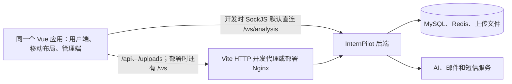

# 前端技术框架与开发约定

`frontend/` 是 InternPilot 的单个 Vue 3 应用，使用同一套源码呈现桌面用户页面、移动端布局和管理后台。本文记录当前已实现的技术与开发约定；界面设计资料可用于理解历史意图，但实际行为以路由、组件、接口封装和实际验证结果为准。案例中的独立 H5/Web 工程、NFC、JetLinks、Nuxt UI、Tailwind CSS 与 pnpm 均不属于本项目现状。

## 技术选型

| 类别 | 当前选型 | 在项目中的用途 |
| --- | --- | --- |
| 框架 | Vue 3 单页应用 | 单文件组件和组合式 API；入口在 [main.ts](../frontend/src/main.ts)。 |
| 构建与语言 | Vite、TypeScript、`vue-tsc` | 开发服务、模块处理、类型检查和生产构建。 |
| 组件与样式 | Element Plus、Sass | 表单、表格、弹窗及全局样式；`src/styles/` 维护设计 token 和组件覆盖。 |
| 路由 | Vue Router | History 路由、登录检查和带权限标记的页面跳转。 |
| 共享状态 | Pinia | 当前用户、AI 任务中心和反馈状态。 |
| 接口请求 | Axios | 基础地址、Bearer token、超时、业务响应解包与通用错误提示。 |
| 图表与实时通信 | ECharts、SockJS、STOMP | 看板图表及 AI 任务进度。 |
| 测试 | Vitest、Vue Test Utils、jsdom | 页面、组件、路由、状态和接口契约测试。 |
| 包管理 | npm | 依赖由 [package.json](../frontend/package.json) 与 [package-lock.json](../frontend/package-lock.json) 记录，CI 使用 `npm ci`。 |

CI 和 Docker 构建使用 Node.js 20；`package.json` 尚未用 `engines` 锁定本地 Node 版本，开发机应与 CI 对齐。依赖的实际版本以锁文件为准，不把其他项目的版本升级建议直接当作本项目要求。

## 页面职责与终端适配

前端只有一个工程，不区分 `h5/` 和 `web/` 两套应用。浏览器通过相同的路由和 API 使用功能；桌面与手机的差异由现有布局组件和响应式样式处理。

| 使用场景 | 当前入口与页面 | 交互重点 |
| --- | --- | --- |
| 普通用户 | `/dashboard`、`/resumes`、`/jobs`、`/analysis/...`、`/interview-questions`、`/applications` | 简历管理、岗位与推荐、AI 分析、面试准备、投递追踪及用户中心。 |
| 管理后台 | `/admin/...` | 用户、角色、权限、RAG 知识库、操作日志和反馈管理；入口与操作按权限显示。 |
| 手机浏览器 | 与用户端共用路由和数据 | 底部导航、窄屏表单、触控操作、抽屉及长内容适配；不是独立安装包或独立 API。 |
| 打印页面 | `/analysis/reports/:id/print` | 独立报告呈现和打印布局，变更报告时需单独检查。 |

用户端导航由 [navigation.ts](../frontend/src/config/navigation.ts) 定义，`AppLayout.vue`、`JourneyNav.vue` 和 `MobileBottomNav.vue` 负责对应布局；管理端使用 `AdminLayout.vue` 与 `AdminSidebar.vue`。本地保留的 UI 设计文档是历史设计基线，公开开发约定以本节和当前代码为准。修改布局时同时检查桌面与手机的加载、空数据、失败、权限受限和键盘操作状态。

## 系统对接方式



- 浏览器调用 InternPilot 后端处理业务；鉴权、数据归属和状态转换由后端最终确认。前端不连接数据库，也不持有 AI、邮件或短信服务的私密凭据。
- [vite.config.ts](../frontend/vite.config.ts) 在开发时使用 5173 端口，将 `/api`、`/uploads` 代理到本机 8080 后端；它没有配置 `/ws` 代理。[analysisSocket.ts](../frontend/src/utils/analysisSocket.ts) 默认直接连接 `http://localhost:8080/ws/analysis`，或使用配置的 `VITE_API_BASE_URL`。`npm run dev` 允许本机网络访问，开发时应留意所处网络环境。
- 部署镜像使用 [nginx.conf](../frontend/nginx.conf) 提供静态文件、History 路由回退，并代理 `/api/`、`/uploads/`、`/ws/` 等路径。开发代理和生产代理不是同一配置；联调和部署分别核对。
- AI 进度使用现有 SockJS/STOMP 工具和任务中心状态。修改长任务页面时，要检查断线、重复通知、页面刷新、取消和失败恢复；任务是否完成以服务端结果为准。

## 工程结构

```text
frontend/
├── package.json / package-lock.json
├── index.html
├── vite.config.ts / vitest.config.ts
├── tsconfig*.json
├── Dockerfile / nginx.conf
├── public/                  # 构建时原样复制的静态文件
└── src/
    ├── main.ts / App.vue   # 应用入口与根组件
    ├── views/              # 按业务域组织的页面
    ├── components/         # 布局、通用组件、AI 和反馈组件
    ├── api/                # 按业务域封装的后端请求
    ├── router/             # 路由和导航守卫
    ├── stores/             # Pinia 共享状态
    ├── config/             # 导航等前端配置
    ├── styles/             # 全局样式、Element Plus 覆盖和设计 token
    ├── utils/              # 请求、token、WebSocket 等工具
    ├── types/              # 补充类型声明
    └── test/               # Vitest 测试初始化
```

`node_modules/`、`dist/` 和 `*.tsbuildinfo` 是本地依赖或构建产物，已被忽略；正式源码和配置应以 Git 跟踪的文件为准。页面通常通过 `src/api/` 调用后端，避免在多个组件中重复写 URL、鉴权头和全局错误处理。

## 路由、登录与权限

[router/index.ts](../frontend/src/router/index.ts) 使用 `createWebHistory()`。`/login`、`/register` 和 `/403` 标记为公开页面；其他页面先检查本地 token，必要时拉取当前用户。部分管理和业务路由有 `meta.permission`，守卫发现缺少权限会跳到 `/403`。

token 目前由 [token.ts](../frontend/src/utils/token.ts) 存在浏览器 `localStorage`，键名为 `internpilot_token`。这是当前实现，不应在日志、错误上报或截图中泄露 token；涉及脚本注入或第三方脚本的改动需考虑本地存储被读取的风险。前端路由守卫和按钮可见性只是用户体验控制，不能代替后端的 401/403、资源所属关系及操作权限检查。

新增页面或操作时，同步核对路由、导航项、权限标记、后端权限、无权限提示和直接输入 URL 的行为。`meta.permission` 仅对显式标记的路由生效；不能因为页面能进入就推断某个写操作获得授权。

## 请求与错误处理

[request.ts](../frontend/src/utils/request.ts) 建立 Axios 实例，默认基础地址取 `VITE_API_BASE_URL`，未配置时使用同源路径；请求超时为 60 秒。有 token 时发送 `Authorization: Bearer <token>`。

后端响应体使用 `code`、`message`、`data`。当前请求拦截器仅在业务 `code === 200` 时返回 `data`；业务失败会拒绝 Promise 并显示友好提示，`code === 401` 或 HTTP 401 会清除 token 并跳转登录。个别调用可用 `silentError` 避免重复弹出通用提示；页面应自行处理操作上下文。HTTP 状态与业务码不一定相同，接口变更要同时检查两者及前端调用方。

前端表单校验用于及时提示用户，重复提交、数据归属、文件限制和权限仍由后端验证。危险操作在服务端确认后再显示成功和更新列表；请求失败时保留可理解的状态与重试路径。

## 界面与状态约定

- 新页面沿用 Vue 单文件组件和现有 `<script setup lang="ts">` 写法；接口数据定义 TypeScript 类型，页面内短暂状态用 Vue 响应式能力，跨页面共享状态再进入 Pinia。
- 使用 Element Plus 和 `src/styles/` 的设计 token 维护颜色、间距与组件状态；不要把案例中的 Nuxt UI、Tailwind CSS 或 Soybean Admin 当作本仓库现有依赖。
- 用户端保持工作台、简历、岗位、分析、面试和投递的现有导航语义；管理端保持权限驱动的侧栏分组。调整导航时同时检查桌面、窄屏和直接访问路径。
- 页面至少处理加载、空数据、失败和权限受限状态。表单、表格、抽屉、对话框、长文本与打印页面应分别检查键盘焦点、标签、窄屏滚动和触控可用性。
- AI 任务中心在本地持久化部分任务展示状态；修改恢复逻辑时要区分浏览器保存的展示状态与后端权威任务状态，避免刷新后重复完成或丢失失败提示。

## 环境、构建与验证

`VITE_` 前缀的变量会进入浏览器构建产物，只可放公开配置，例如 API 地址；后端 JWT 密钥、数据库密码、AI 密钥和短信凭据必须保留在后端环境。仓库当前没有必须使用的前端 `.env.example`；新增变量时应写明默认行为、不同环境的值来源和部署影响。

从仓库根目录运行：

```powershell
cd frontend
npm ci
npm run dev
npm run test:run
npm run build
```

`npm run build` 先执行 `vue-tsc -b`，再执行 Vite 生产构建，输出到 `frontend/dist/`；单独排查类型问题可运行 `npm run type-check`。测试使用 `vitest.config.ts` 中的 jsdom 环境，通常位于相关源码旁的 `__tests__/`。具体选择和结果报告见 [测试规范](test.md)，CI 命令见 [工作流](../.github/workflows/ci.yml)。

页面、路由、请求封装和共享状态变更应运行相关 Vitest 测试及构建；重要用户流程还要在桌面和手机视口联调成功、空、失败、401/403 路径。类型检查和模拟测试不能证明真实后端、WebSocket 或生产 Nginx 配置可用。部署前结合 [README 部署说明](../README.md#部署说明)核对目标环境。
