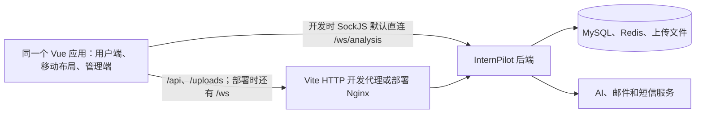

# 前端技术框架与开发约定

> **UI 重设计索引** · [需求与验收](requirements/06-frontend-ui-redesign-requirements.md) · [概要设计](architecture-overview/05-frontend-ui-redesign-outline.md) · [详细设计与建模](detailed-design-modeling/34-frontend-ui-redesign-modeling.md)

`frontend/` 是 InternPilot 的单个 Vue 3 应用，使用同一套源码呈现桌面用户页面、移动端布局和管理后台。技术选型表记录当前实现，界面与状态约定指导后续开发。已上线功能的实际行为以目标提交的源码和对应环境的验证结果为准。

## 技术选型

| 类别 | 当前选型 | 在项目中的用途 |
| --- | --- | --- |
| 框架 | Vue 3 单页应用 | 单文件组件和组合式 API；入口在 [main.ts](../frontend/src/main.ts)。 |
| 构建与语言 | Vite、TypeScript、`vue-tsc` | 开发服务、模块处理、类型检查和生产构建。 |
| 组件与样式 | Element Plus、Sass、Tailwind CSS v4、shadcn-vue Button | C 端页面用 shadcn-vue Button 承载简单的主要操作。Element Plus 负责现有表单、表格、上传和弹窗，后台继续使用 Element Plus 与局部 SCSS。 |
| 路由 | Vue Router | History 路由、登录检查和带权限标记的页面跳转。 |
| 共享状态 | Pinia | 当前用户、AI 任务中心和反馈状态。 |
| 接口请求 | Axios | 基础地址、Bearer token、超时、业务响应解包与通用错误提示。 |
| 图表与实时通信 | ECharts、SockJS、STOMP | 看板图表及 AI 任务进度。 |
| 测试 | Vitest、Vue Test Utils、jsdom | 页面、组件、路由、状态和接口契约测试。 |
| 包管理 | npm | 依赖由 [package.json](../frontend/package.json) 与 [package-lock.json](../frontend/package-lock.json) 记录，CI 使用 `npm ci`。 |

CI 和 Docker 构建使用 Node.js 20；`package.json` 尚未用 `engines` 锁定本地 Node 版本，开发机应与 CI 对齐。依赖的实际版本以锁文件为准，不把其他项目的版本升级建议直接当作本项目要求。

## 页面职责与终端适配

前端只有一个工程，不区分 `h5/` 和 `web/` 两套应用。浏览器通过相同的路由和 API 使用功能；桌面与手机的差异由现有布局组件和响应式样式处理。

| 使用场景 | 当前入口与页面 | 交互重点 |
| --- | --- | --- |
| 公开介绍 | `/`、`/sample-report` | 用同一份全栈开发实习案例展示匹配、简历优化与版本、面试准备和投递追踪。访客可匿名查看样例报告。 |
| 普通用户 | `/dashboard`、`/resumes`、`/jobs`、`/analysis/...`、`/interview-questions`、`/applications` | 简历管理、岗位与推荐、AI 分析、面试准备、投递追踪及用户中心。 |
| 管理后台 | `/admin/...` | 用户、角色、权限、RAG 知识库、操作日志和反馈管理；入口与操作按权限显示。 |
| 手机浏览器 | 与用户端共用路由和数据 | 底部导航、窄屏表单、触控操作、抽屉及长内容适配；不是独立安装包或独立 API。 |
| 打印页面 | `/analysis/reports/:id/print` | 独立报告呈现和打印布局，变更报告时需单独检查。 |

用户端导航由 [navigation.ts](../frontend/src/config/navigation.ts) 定义。`AppLayout.vue` 在 1024px 起显示浅色侧栏，在更窄的视口使用底部导航。管理端使用 `AdminLayout.vue` 与 `AdminSidebar.vue`，在 900px 及以下通过抽屉打开权限导航。修改布局时同时检查桌面与手机的加载、空数据、失败、权限受限和键盘操作状态。

## 系统对接方式



- 浏览器调用 InternPilot 后端处理业务；鉴权、数据归属和状态转换由后端最终确认。前端不连接数据库，也不持有 AI、邮件或短信服务的私密凭据。
- [vite.config.ts](../frontend/vite.config.ts) 在开发时使用 5173 端口，将 `/api`、`/uploads` 代理到本机 8080 后端；它没有配置 `/ws` 代理。[analysisSocket.ts](../frontend/src/utils/analysisSocket.ts) 默认直接连接 `http://localhost:8080/ws/analysis`，或使用配置的 `VITE_API_BASE_URL`。`npm run dev` 允许本机网络访问，开发时应留意所处网络环境。
- 部署镜像使用 [nginx.conf](../frontend/nginx.conf) 提供静态文件、History 路由回退，并代理 `/api/`、`/uploads/`、`/ws/` 等路径。开发代理和生产代理不是同一配置；联调和部署分别核对。
- AI 进度使用现有 SockJS/STOMP 工具和任务中心状态。修改长任务页面时，要检查断线、重复通知、页面刷新、取消和失败恢复；任务是否完成以服务端结果为准。

## 工程结构

```text
frontend/
├── package.json / package-lock.json
├── index.html
├── vite.config.ts / vitest.config.ts
├── tsconfig*.json
├── Dockerfile / nginx.conf
├── public/                  # 构建时原样复制的静态文件
└── src/
    ├── main.ts / App.vue   # 应用入口与根组件
    ├── views/              # 按业务域组织的页面
    ├── components/         # 布局、通用组件、AI 和反馈组件
    ├── api/                # 按业务域封装的后端请求
    ├── router/             # 路由和导航守卫
    ├── stores/             # Pinia 共享状态
    ├── config/             # 导航等前端配置
    ├── styles/             # 全局样式、Element Plus 覆盖和设计 token
    ├── utils/              # 请求、token、WebSocket 等工具
    ├── types/              # 补充类型声明
    └── test/               # Vitest 测试初始化
```

`node_modules/`、`dist/` 和 `*.tsbuildinfo` 是本地依赖或构建产物，已被忽略；正式源码和配置应以 Git 跟踪的文件为准。页面通常通过 `src/api/` 调用后端，避免在多个组件中重复写 URL、鉴权头和全局错误处理。

## 路由、登录与权限

[router/index.ts](../frontend/src/router/index.ts) 使用 `createWebHistory()`。`/`、`/sample-report`、`/login`、`/register` 和 `/403` 标记为公开页面；其他页面先检查本地 token，必要时拉取当前用户。部分管理和业务路由有 `meta.permission`，守卫发现缺少权限会跳到 `/403`。

token 目前由 [token.ts](../frontend/src/utils/token.ts) 存在浏览器 `localStorage`，键名为 `internpilot_token`。这是当前实现，不应在日志、错误上报或截图中泄露 token；涉及脚本注入或第三方脚本的改动需考虑本地存储被读取的风险。前端路由守卫和按钮可见性只是用户体验控制，不能代替后端的 401/403、资源所属关系及操作权限检查。

新增页面或操作时，同步核对路由、导航项、权限标记、后端权限、无权限提示和直接输入 URL 的行为。`meta.permission` 仅对显式标记的路由生效；不能因为页面能进入就推断某个写操作获得授权。

## 请求与错误处理

[request.ts](../frontend/src/utils/request.ts) 建立 Axios 实例，默认基础地址取 `VITE_API_BASE_URL`，未配置时使用同源路径；请求超时为 60 秒。有 token 时发送 `Authorization: Bearer <token>`。

后端响应体使用 `code`、`message`、`data`。当前请求拦截器仅在业务 `code === 200` 时返回 `data`；业务失败会拒绝 Promise 并显示友好提示，`code === 401` 或 HTTP 401 会清除 token 并跳转登录。个别调用可用 `silentError` 避免重复弹出通用提示；页面应自行处理操作上下文。HTTP 状态与业务码不一定相同，接口变更要同时检查两者及前端调用方。

前端表单校验用于及时提示用户，重复提交、数据归属、文件限制和权限仍由后端验证。危险操作在服务端确认后再显示成功和更新列表；请求失败时保留可理解的状态与重试路径。

## 界面与状态约定

### 两端的组件选型

- **C 端**借鉴 Reactive Resume 的内容层级和文档工作区。新开发的按钮、标签、页签等基础组件优先采用 shadcn-vue，使用 Reka UI 提供的交互原语和 Tailwind CSS v4。现有 Element Plus 上传、表单、抽屉和确认弹窗按需迁移，替换时检查键盘操作、焦点恢复和错误反馈。参考 [Reactive Resume](https://github.com/reactive-resume/reactive-resume)。
- **管理后台**借鉴 Art Design Pro 的分组导航、紧凑筛选区和表格布局。筛选、表格、分页、表单和弹窗统一使用 Element Plus 配合局部 SCSS，优先复用后台已有公共组件。参考 [Art Design Pro](https://github.com/Daymychen/art-design-pro) 和现有 [AdminResultTable.vue](../frontend/src/views/admin/AdminResultTable.vue)。

### 主题与样式

- 两端共用 `tokens.scss` 中的品牌色、状态色、间距和圆角等 CSS 变量。管理后台可按需调整侧栏配色和表格密度。Tailwind 通过 `@theme inline` 引用共享变量，Element Plus 通过 `element.scss` 中的 `--el-*` 变量对接。参见 [tokens.scss](../frontend/src/styles/tokens.scss)、[resume-utilities.css](../frontend/src/styles/resume-utilities.css) 和 [element.scss](../frontend/src/styles/element.scss)。
- C 端布局按路由加载 Tailwind 主题与工具类，使用 `ip:` 前缀和显式 `@source`，保持 Preflight 关闭。扫描范围覆盖 C 端业务页面和 Button。扩展后，在同一个浏览器标签页从 C 端切换到后台和报告打印页，并与直接打开时的表现对比，检查样式是否串页。

- C 端默认 Clario，可在账号菜单的「外观设置」切换 LiquidGlass 或定制桌面布局、菜单与主色。设置面板先预览，保存后按账号和端写入当前浏览器；取消恢复上次保存值。
- 管理后台默认浅色和浅色侧栏。工作页签只记录已有权限的后台路由，有权限时固定后台看板；页签保存于当前浏览器标签的登录会话，退出登录时清除。
- 工作台的下一步沿用五阶段判断，近期资料来自简历、匹配报告列表，日程来自投递记录中的未来面试时间。

### 页面行为

- [公开首页](../frontend/src/views/landing/Landing.vue) 和样例报告共用本地合成案例，渲染时无业务请求。吸顶导航在页首透明，下滑后显示清透玻璃，不支持背景模糊时使用实白。会话标记决定注册或工作台入口，进入 `/dashboard` 后由[路由守卫](../frontend/src/router/index.ts)校验会话。修改公开页时检查键盘焦点、减少动态效果、章节锚点和匿名访问。
- 头像菜单和个人中心主动退出清除当前会话并替换为公开首页。当前会话失效仍引导登录，携带旧会话令牌的迟到 `401` 不得清除另一个会话或触发跳转。
- [样例报告](../frontend/src/views/landing/SampleReport.vue) 与首屏共用合成案例，直接渲染岗位要求、匹配依据、简历前后对照和面试建议。公开样例的加载独立于真实报告接口。
- 新页面沿用 Vue 单文件组件和现有 `<script setup lang="ts">` 写法；接口数据定义 TypeScript 类型，页面内短暂状态用 Vue 响应式能力，跨页面共享状态再进入 Pinia。
- 用户端保持工作台、简历、岗位、分析、面试和投递的现有导航语义；管理端保持权限驱动的侧栏分组。调整导航时同时检查桌面、窄屏和直接访问路径。
- 页面至少处理加载、空数据、失败和权限受限状态。表单、表格、抽屉、对话框、长文本与打印页面应分别检查键盘焦点、标签、窄屏滚动和触控可用性。
- AI 任务中心在本地持久化部分任务展示状态；修改恢复逻辑时要区分浏览器保存的展示状态与后端权威任务状态，避免刷新后重复完成或丢失失败提示。

## 环境、构建与验证

`VITE_` 前缀的变量会进入浏览器构建产物，只可放公开配置，例如 API 地址；后端 JWT 密钥、数据库密码、AI 密钥和短信凭据必须保留在后端环境。仓库当前没有必须使用的前端 `.env.example`；新增变量时应写明默认行为、不同环境的值来源和部署影响。

从仓库根目录运行：

```powershell
cd frontend
npm ci
npm run dev
npm run test:run
npm run build
```

`npm run build` 先执行 `vue-tsc -b`，再执行 Vite 生产构建，输出到 `frontend/dist/`；单独排查类型问题可运行 `npm run type-check`。测试使用 `vitest.config.ts` 中的 jsdom 环境，通常位于相关源码旁的 `__tests__/`。具体选择和结果报告见 [测试规范](test.md)，CI 命令见 [工作流](../.github/workflows/ci.yml)。

页面、路由、请求封装和共享状态变更应运行相关 Vitest 测试及构建；重要用户流程还要在桌面和手机视口联调成功、空、失败、401/403 路径。类型检查和模拟测试不能证明真实后端、WebSocket 或生产 Nginx 配置可用。部署前结合 [README 部署说明](../README.md#部署说明)核对目标环境。
